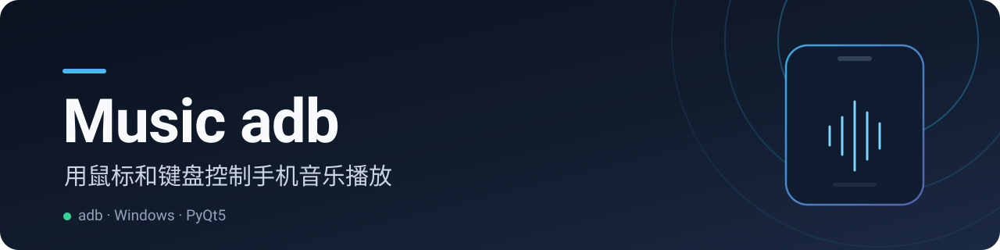
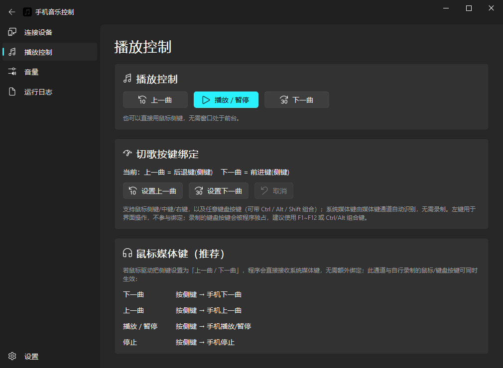
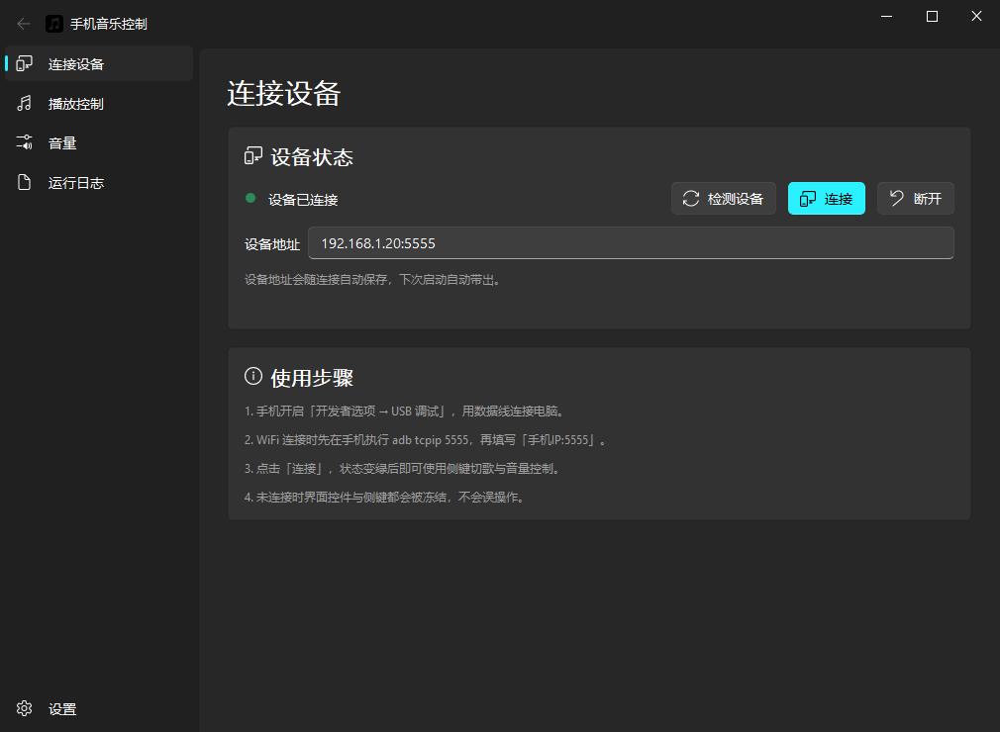
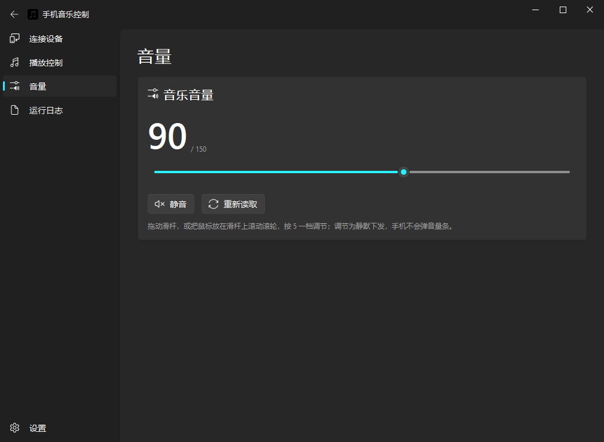
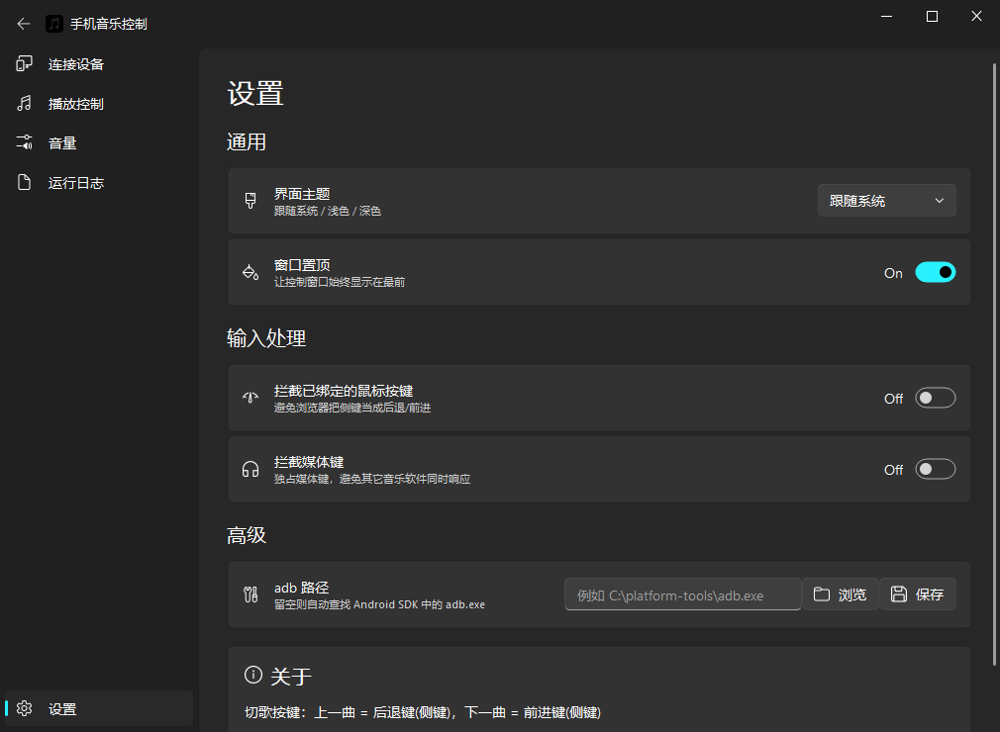
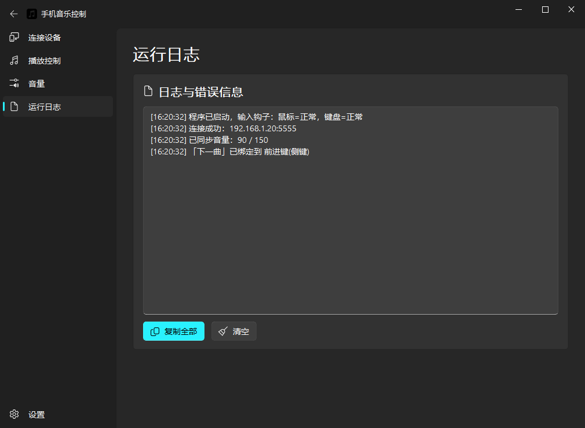

<p align="center">
  
</p>

<h1 align="center">Music adb</h1>

<p align="center">用鼠标侧键和滑杆直接控制手机上的音乐播放 —— 电脑连着手机，adb 负责执行，你不用再拿起手机。</p>

<p align="center">
  <a href="https://github.com/GUY-ATM/Music-adb/releases/latest"></a>
  <a href="https://github.com/GUY-ATM/Music-adb/releases"></a>
  <a href="LICENSE"></a>
</p>

手机连着电脑的时候，切歌得先摸到手机、调音量还得看音量条 —— 这个工具把这套动作搬到鼠标上：侧键切上一曲 / 下一曲，滑杆或滚轮调音量，全部通过 adb 静默下发。它是一个 Windows 桌面小工具，不做音乐播放，也不接管手机的通知与蓝牙。

## 界面

播放控制页（已连接状态）：

<p align="center">
  
</p>

<table>
  <tr>
    <td width="50%"></td>
    <td width="50%"></td>
  </tr>
  <tr>
    <td width="50%"></td>
    <td width="50%"></td>
  </tr>
</table>

## 功能

- **切歌与播放控制** — 上一曲、下一曲、播放 / 暂停、停止，通过 `cmd media_session dispatch` 下发，不依赖手机前台应用。
- **任意按键绑定** — 点「设置上一曲 / 设置下一曲」，按一下目标按键即可：鼠标侧键、中键、右键，或任意键盘按键（可带 `Ctrl` / `Alt` / `Shift` 组合）。`Esc` 或「取消」退出录制。
- **系统媒体键通道** — 鼠标驱动把侧键映射为「上一曲 / 下一曲」时，程序直接接收系统媒体键，无需绑定；该通道与录制的按键可同时生效。
- **音量滑杆 + 滚轮** — 拖动滑杆或滚动滚轮（5 一档）调节，按差值分档静默下发并回读收敛，手机不会弹音量条；支持静音 / 取消静音。
- **托盘图标滚轮调音量** — 程序常驻任务栏通知区域，鼠标移到图标上滚动滚轮即可调音量，鼠标不用离开当前工作窗口；右键菜单可调出主界面、重读音量、静音或退出。
- **USB 与 WiFi 连接** — 数据线直连，或 `adb tcpip 5555` 后填 `手机IP:5555`；自动检测设备，支持手动指定 `adb.exe` 路径。
- **未连接即冻结** — 没有连接设备时，播放、音量、绑定按钮与全局按键全部失效，不会误触发。
- **可复制的运行日志** — 连接、同步、绑定与 adb 报错都进日志页，一键复制排查。
- **Fluent 界面** — 深色 / 浅色 / 跟随系统主题可记忆，标题栏按钮随主题自适应。

## 下载

从 [Releases](https://github.com/GUY-ATM/Music-adb/releases/latest) 下载 `PhoneMusicController.exe`，双击即可运行，不需要安装 Python。

> Windows 首次运行时如遇 SmartScreen 提示，选择「更多信息 → 仍要运行」。

## 使用

1. 手机开启「开发者选项 → USB 调试」，用数据线连接电脑（首次连接在手机上确认授权）。
2. 打开程序，点击「连接」，状态圆点变绿即表示就绪。
3. 想改键就点「设置上一曲 / 设置下一曲」，按下目标按键；不改则默认使用鼠标后退键 / 前进键。
4. 到「音量」页拖动滑杆或滚动滚轮调节音量。
5. 想随时调音量，可以把通知区域里的托盘图标拖到任务栏上固定（在「^」浮层里就按住拖出来），之后鼠标停在图标上滚动滚轮即可调节。

WiFi 连接：先在手机执行 `adb tcpip 5555`，断开数据线后在「设备地址」填 `192.168.x.x:5555` 再连接。

## 从源码运行

需要 Python 3.9 及以上（开发与打包环境为 3.13），以及 PyQt5、PyQt-Fluent-Widgets；adb 可用 Android SDK 自带的，也可在设置页指定路径。

```sh
git clone https://github.com/GUY-ATM/Music-adb.git
cd Music-adb
pip install PyQt5 PyQt-Fluent-Widgets
python phone_music_controller.py
```

运行后主窗口出现，先去「连接设备」页连接手机。

## 配置项

配置保存在程序同目录的 `config.json`，可由界面写入，也可手动编辑（下次启动生效）：

| 字段 | 默认值 | 说明 |
| --- | --- | --- |
| `adb_path` | `""` | `adb.exe` 路径；留空则自动查找 Android SDK |
| `device` | `""` | 设备序列号或 `IP:5555`；USB 直连留空 |
| `prev_button` | `x1` | 上一曲绑定：`x1` / `x2` / `middle` / `right`，或 `vk:<键码>[+ctrl/+alt/+shift]` |
| `next_button` | `x2` | 下一曲绑定，格式同上 |
| `swallow_bound` | `false` | 拦截已绑定的鼠标按键，避免浏览器把它当成后退 / 前进 |
| `swallow_media_keys` | `false` | 独占媒体键，避免其它音乐软件同时响应 |
| `topmost` | `true` | 窗口置顶 |
| `theme` | `auto` | 界面主题：`auto` / `light` / `dark` |

## 工作原理

| 功能 | 实现 |
| --- | --- |
| 切歌 | `adb shell cmd media_session dispatch next` / `previous` / `play-pause` / `stop` |
| 音量 | `adb shell cmd audio adj-volume 3 RAISE` / `LOWER`，`MUTE` / `UNMUTE`；绝对值按差值分档下发并回读收敛 |
| 按键捕获 | Win32 低级钩子 `WH_MOUSE_LL` / `WH_KEYBOARD_LL`，钩子与消息循环同线程 |
| 免闪窗 | 所有 adb 调用使用 `CREATE_NO_WINDOW` |

部分系统（如 HyperOS）会拒绝 `input keyevent` 并抛出 `INJECT_EVENTS permission`，因此这里统一走 `media_session` 与 `audio` 命令通道。

<details>
<summary>项目结构</summary>

```text
Music-adb/
├── main.py                    # 入口：高 DPI、配置加载、后台线程、全局钩子、主窗口
├── phone_music_controller.py  # 兼容旧入口，转调 main.main
├── app/
│   ├── config.py              # 配置读写、按键绑定解析与显示
│   ├── adb.py                 # adb 查找、命令下发、音量读写
│   ├── bus.py                 # 线程间队列与连接状态
│   ├── worker.py              # adb 串行执行线程
│   ├── input_hooks.py         # 鼠标 / 键盘低级钩子、媒体键、按键录制与托盘滚轮
│   ├── tray.py                # 托盘图标、右键菜单与图标屏幕位置
│   └── ui/                    # 主窗口与五个页面
├── tests/test_core.py         # 核心逻辑单元测试
├── legacy/                    # 迁移前的 Tkinter 版本备份
└── run_photo/                 # 运行界面截图
```

</details>

## 已知限制

- 录制的键盘按键会被程序独占，不再输入到其它窗口，建议使用 `F1`~`F12` 或 `Ctrl` / `Alt` 组合键。
- 「拦截已绑定的鼠标按键」与「拦截媒体键」默认关闭；开启后会独占这些按键，其它软件将收不到。
- 音量下发依赖手机系统支持 `cmd audio adj-volume`，个别定制系统可能需要手动调一次音量让系统接受该通道。
- 托盘图标默认会被 Windows 收进「^」浮层，需要在浮层里把它拖到任务栏上固定后才能滚轮调音量；程序检测到图标被折叠时会在日志页给出提示。

## 开发

```sh
python tests/test_core.py
```

15 项单元测试覆盖配置校正与往返、键盘绑定解析与显示、音量解析与绝对值收敛、adb 命令通道与鼠标消息解析。

打包 Windows 单文件 EXE：

```sh
pyinstaller PhoneMusicController.spec --distpath dist --workpath build --noconfirm
```

## 贡献

欢迎提交 Issue 与 Pull Request。改动前请先跑一遍上面的单元测试；涉及 adb 命令的改动请附上目标机型的实测结果。

## License

[MIT](LICENSE)
